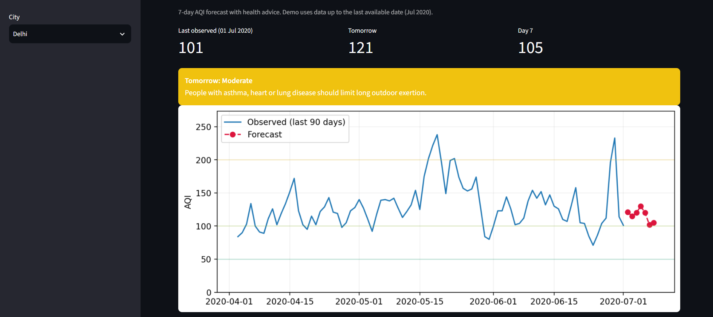
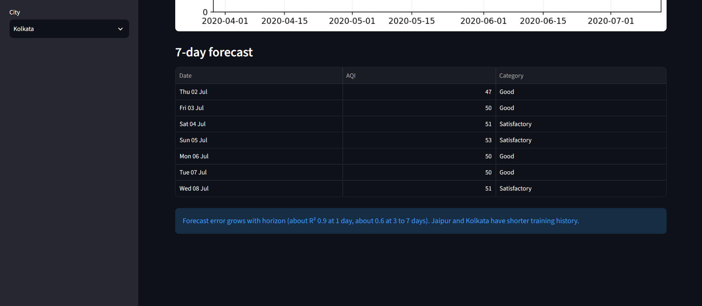
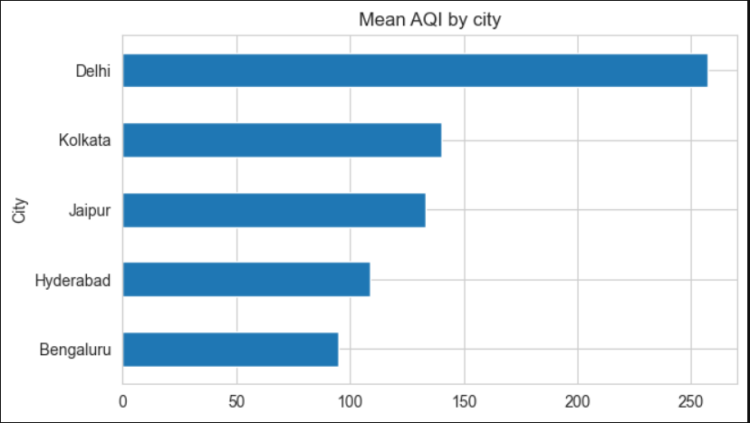
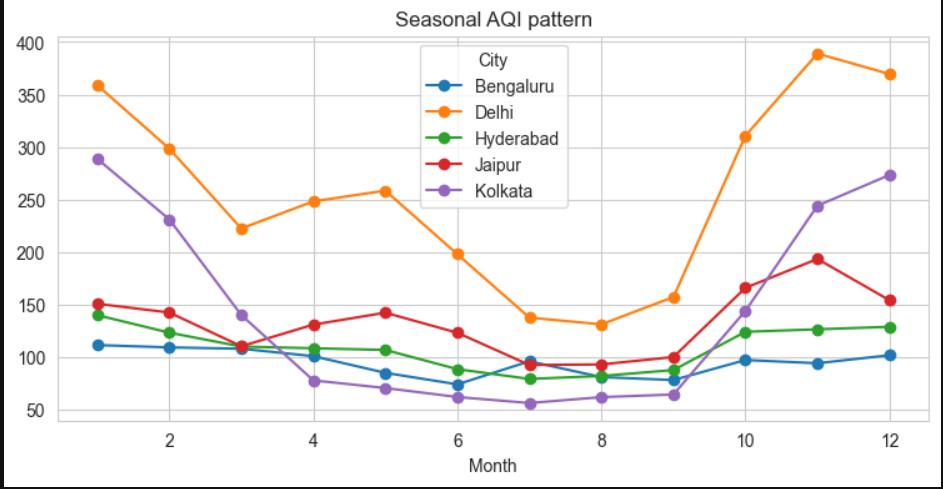
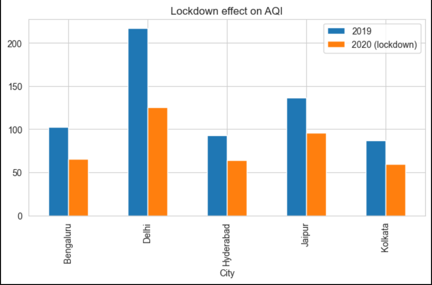
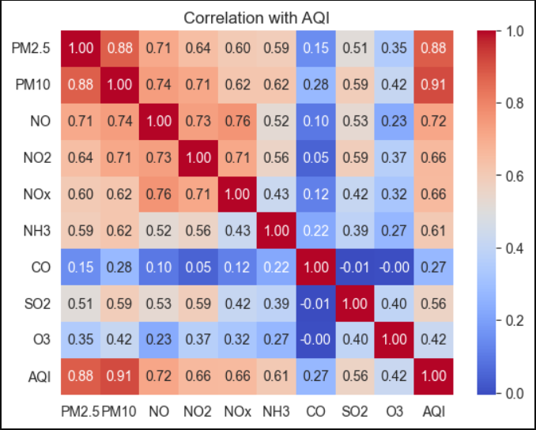
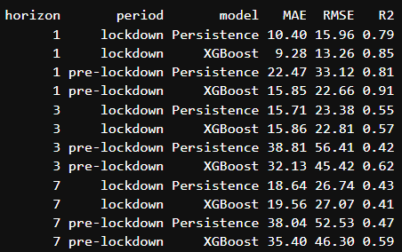
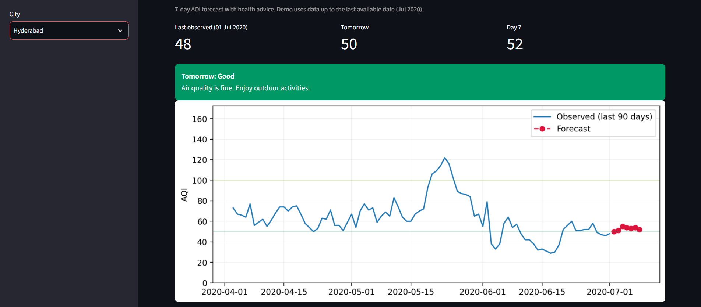
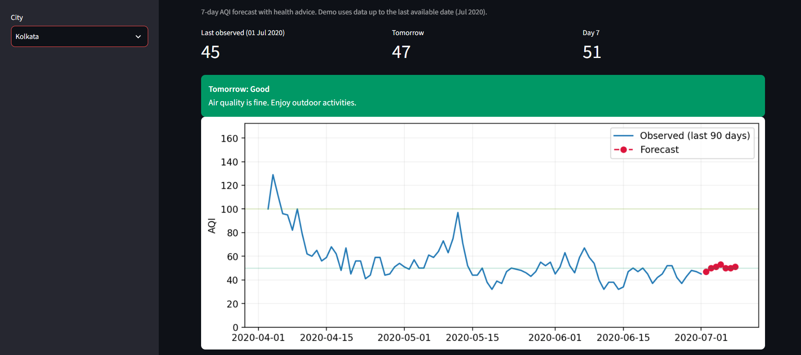

# AQI Forecasting for Indian Cities

7-day Air Quality Index (AQI) forecasts for five Indian cities, with pollutant analysis and a health-advice dashboard.

Built as a final year project at IIT (ISM) Dhanbad by **Conor**.




## What it does

- Forecasts daily AQI **1 to 7 days ahead** for Delhi, Jaipur, Kolkata, Bengaluru and Hyderabad.
- Compares models against a **persistence baseline** (tomorrow = today) with a time-based train/test split.
- Studies seasonal patterns and the **COVID-19 lockdown** (2020) as a natural experiment.
- Explains the forecasts with **SHAP**.
- Shows the forecast in a **Streamlit** app with CPCB AQI categories and health advice.

## Data

[Air Quality Data in India (2015-2020)](https://www.kaggle.com/) on Kaggle (`city_day.csv`), daily PM2.5, PM10, NO, NO2, NOx, NH3, CO, SO2, O3 and AQI. Search the dataset title on Kaggle to download it. The file is not included in this repo.

Cities were chosen by data coverage and to give a north / west / east / south mix. Mumbai (39% AQI coverage), Ahmedabad, Chennai and Lucknow were excluded for missing data.

| City | Start | Clean rows |
|---|---|---|
| Delhi | Jan 2015 | 2008 |
| Bengaluru | Mar 2015 | 1895 |
| Hyderabad | Mar 2015 | 1901 |
| Jaipur | Jun 2017 | 1106 |
| Kolkata | Apr 2018 | 757 |

All cities end on 1 Jul 2020.

## Method

1. **Cleaning:** daily frequency per city, interpolation of gaps up to 3 days only, AQI capped at 500 (CPCB scale), rows missing AQI or PM2.5 dropped.
2. **Features:** AQI lags (1, 2, 3, 7, 14), rolling means (7 and 30 days), yesterday's PM2.5, all pollutants, month, day of week, day-of-year sin/cos, city code.
3. **Models:** one model per horizon (1 to 7 days). Persistence baseline, XGBoost on the AQI level, and XGB-delta, which predicts the change from today's AQI.
4. **Split:** train up to Dec 2019. Test on Jan to 24 Mar 2020 (pre-lockdown) and 25 Mar 2020 onwards (lockdown).

## Exploratory analysis

Delhi has the highest AQI and peaks in November and January. Kolkata has a sharp winter peak and a monsoon low. Bengaluru and Hyderabad stay flat.





Yearly means for 2020 cover Jan to Jul only, so they are not a full-year comparison.

### Lockdown effect

Mean AQI from 25 Mar to 30 Jun 2020 was 30 to 42% lower than the same window in 2019 (Delhi -42.2%, Bengaluru -35.6%, Kolkata -31.2%, Hyderabad -31.0%, Jaipur -29.9%). Weather also differs between years, so this is an association, not proof of cause.



### Correlation with AQI

PM10 (0.91) and PM2.5 (0.88) are closest to AQI. AQI is computed from pollutant sub-indices, so part of this correlation comes from how AQI is defined.



## Results

Test performance (MAE, and R² in the next column of each pair):

| Days | Period | Persist. MAE | R² | XGBoost MAE | R² | XGB-delta MAE | R² |
|---|---|---|---|---|---|---|---|
| 1 | Pre-lockdown | 22.47 | 0.81 | 15.85 | 0.91 | 17.45 | 0.89 |
| 1 | Lockdown | 10.40 | 0.79 | 9.28 | 0.85 | 9.36 | 0.85 |
| 3 | Pre-lockdown | 38.81 | 0.42 | 32.13 | 0.62 | 32.88 | 0.62 |
| 3 | Lockdown | 15.71 | 0.55 | 15.86 | 0.57 | 15.24 | 0.60 |
| 7 | Pre-lockdown | 38.04 | 0.47 | 35.40 | 0.59 | 33.71 | 0.62 |
| 7 | Lockdown | 18.64 | 0.43 | 19.56 | 0.41 | 18.41 | 0.50 |

- Both models beat persistence before lockdown at every horizon.
- Lockdown is a distribution shift. The first XGBoost tied or lost to persistence at 3 and 7 days, while XGB-delta kept an edge. Compare R² across periods, not MAE, because lockdown AQI values were lower.
- Per city, XGB-delta beats persistence everywhere on the pre-lockdown window. Delhi has the largest error (MAE about 60 at 3 and 7 days).

### What drives the forecast (SHAP, 3-day model)

The current AQI and the 30-day rolling mean dominate: high AQI pushes the predicted change down and low AQI pushes it up (mean reversion). Seasonal terms and yesterday's PM2.5 come next. SHAP shows what the model relies on, not what causes pollution.



## Dashboard

Pick a city, see the next 7 days of AQI, the CPCB category colour and health advice.




The demo forecasts from the last date in the data (1 Jul 2020). It does not predict current or future dates without fresh readings.

## Run locally

```bash
git clone <your-repo-url>
cd <repo-folder>
pip install -r requirements.txt
streamlit run app.py
```

The `artifacts/` folder (`aqi_models.joblib`, `latest.csv`, `history.csv`) must sit next to `app.py`. To rebuild it, download `city_day.csv`, place it in the project folder and run the notebook top to bottom.

## Project structure

```
├── app.py              # Streamlit dashboard
├── notebook.ipynb      # cleaning, EDA, modelling, SHAP, saving models
├── artifacts/          # saved models and latest data for the app
├── images/             # figures used in this README
├── requirements.txt
└── README.md
```

## Limitations

- Data ends in July 2020, so the dashboard is a demo, not a live service.
- Jaipur and Kolkata have short histories.
- The pre-lockdown test window is small (84 days per city).
- No weather inputs (wind, temperature, humidity).

## Future work

- Add live CPCB or OpenAQ data and retrain on post-2020 records.
- Add weather features.
- Try LSTM or Transformer models.
- Extend to more cities.